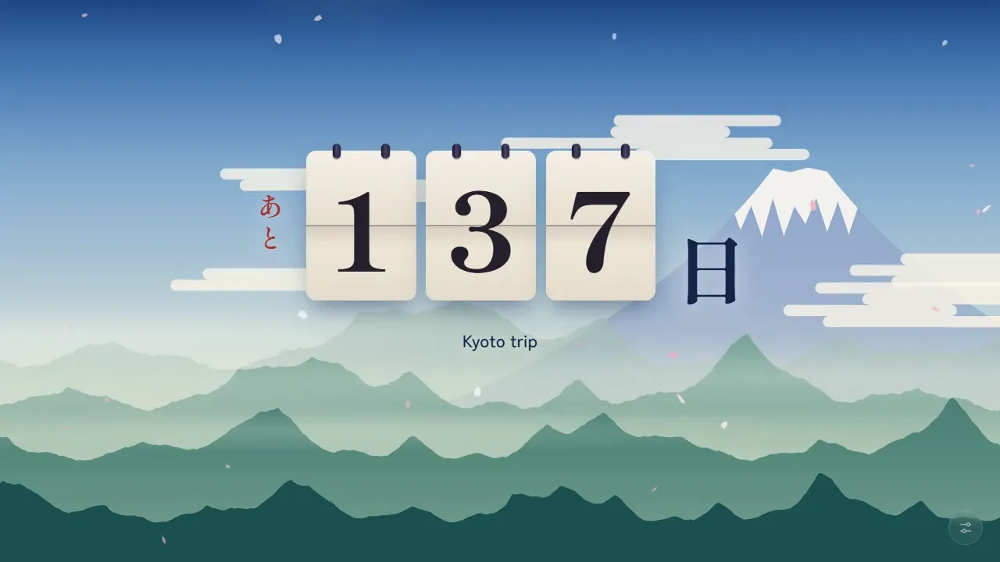
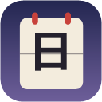
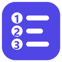

# Cool Chrome Extensions

**Cool Chrome Extensions is a free collection of small Manifest V3 Chrome extensions written in plain JavaScript: a flip-calendar countdown for your new tab page, a tool that numbers repeated items on any web page, and a date organizer for your Grok chat history.**

<p align="center">
  <a href="https://github.com/kyameinsahilwho/cool-chrome-extensions/blob/main/himekuri-day-cycle.mp4"></a>
  
  
  
  
</p>

<p align="center">
  <a href="https://github.com/kyameinsahilwho/cool-chrome-extensions/blob/main/himekuri-day-cycle.mp4">
    
  </a>
  <br>
  <sub>Himekuri Countdown in its afternoon look. Click the image for the 45-second day-cycle video.</sub>
</p>

## Why these extensions

- **No build step.** There is no `package.json`, bundler or framework. Each extension is a folder of HTML, CSS and JavaScript that Chrome loads as is.
- **Small enough to read.** Item Numbers is about 630 lines of code, Himekuri Countdown about 1,500 and the Grok organizer about 1,700.
- **No tracking, no accounts.** None of the three sends analytics or talks to a server of its own. Settings live in `chrome.storage`.
- **Minimal permissions.** Himekuri Countdown asks only for `storage`. The Grok organizer only runs on `grok.com` and `x.ai`.
- **Works on any site.** Item Numbers finds result lists, feeds, product grids and comment threads on its own, with no per-site rules.

## The extensions

| | Extension | What it does | Permissions |
|---|---|---|---|
|  | [Himekuri Countdown](../himekuri-countdown) | Replaces the new tab page with a flip-calendar countdown to a date you choose | `storage` |
|  | [Item Numbers](../item-numbers) | Puts a number on each repeated item of a page so you can keep your place | `storage`, `contextMenus`, `scripting`, `activeTab`, all sites |
|  | [Grok Chat Date Categorizer](../grok-chat-date-categorizer) | Groups your Grok sidebar chats under one header per day | `storage`, `grok.com`, `*.x.ai` |

---

##  Himekuri Countdown

**Himekuri Countdown is a Chrome new tab extension that counts down the days to a date you choose on big flip-calendar cards (あと N 日, "N days left") over an animated Japanese ink-wash landscape.**

- Three display modes: days only, days and hours, or a live countdown to the second.
- The background follows your clock and blends slowly between four looks: morning cranes, Mount Fuji in the afternoon, a torii gate at sunset, and a moonlit night.
- Six background options: follow the time of day, loop a whole day in 5 minutes, or pin one of the four looks.
- Falling sakura petals you can switch off.
- Settings sync through your Chrome account, and every open tab updates when you change the date.
- Respects "reduce motion": the cards and scene stay still.

Install: load the [`himekuri-countdown`](../himekuri-countdown) folder (see [install steps](#install-any-extension)), open a new tab and choose **Keep it** if Chrome asks. Full guide: [himekuri-countdown/README.md](../himekuri-countdown/README.md).

##  Item Numbers

**Item Numbers is a Chrome extension that adds a small number badge to every repeated item on a web page, such as search results, feed posts, product tiles and comments, so you always know which entry you were on.**

- Toggle per tab with the toolbar button or **Alt+Shift+N**. The button shows `ON` while numbering is active.
- Detects lists automatically: 3 or more matching siblings that each have a link or button plus about 20 characters of text or a picture.
- Each separate list gets its own colour (8 colours) and starts again at 1.
- Keeps counting as the page loads more (infinite scroll, filters, "load more").
- Badges sit in a transparent overlay: the page layout never changes and clicks pass straight through.
- Right-click the toolbar button to keep numbering on for a site, or to number nested lists such as replies.

Install: load the [`item-numbers`](../item-numbers) folder and pin the extension. Full guide: [item-numbers/README.md](../item-numbers/README.md).

##  Grok Chat Date Categorizer

**Grok Chat Date Categorizer is a Chrome extension that sorts the chat history in the Grok (xAI) sidebar under one header per day, such as "20 Mar, Friday (Today)", while keeping pinned chats on top.**

- One section per calendar day, newest first, with an optional chat count on each header.
- Group by last active date or by creation date.
- Pinned chats stay at the top in Grok's own order. Project chats are left out of the history list.
- Loads your full history from Grok's own conversations API (100 chats per page, up to 20 pages), then refreshes every 2 minutes and when you return to the tab.
- Clicking, pinning and the options menu use Grok's native controls, and hovering a chat shows its exact timestamp.
- The popup shows totals for all chats, today and the past 7 days.

Install: load the [`grok-chat-date-categorizer`](../grok-chat-date-categorizer) folder, then open or refresh grok.com. Full guide: [grok-chat-date-categorizer/README.md](../grok-chat-date-categorizer/README.md).

---

## Install any extension

None of these needs a build. You load the folder straight into Chrome.

1. Download or clone the repository:
   ```bash
   git clone https://github.com/kyameinsahilwho/cool-chrome-extensions.git
   ```
2. Open `chrome://extensions` and turn on **Developer mode** (top right).
3. Click **Load unpacked** and select the extension's folder, for example `cool-chrome-extensions/item-numbers`. Select the subfolder, not the repository root.
4. Repeat step 3 for each extension you want.

To update later, run `git pull` and click the reload icon on the extension's card in `chrome://extensions`.

## Tech stack

- Chrome Extensions Manifest V3 (service workers, content scripts, `chrome.storage`, `chrome_url_overrides`, `commands`, `contextMenus`)
- Vanilla JavaScript, HTML and CSS with no dependencies
- Canvas 2D for the Himekuri landscape and the Web Animations API for the flip cards
- Shadow DOM overlay for Item Numbers badges

## FAQ

### Are these Chrome extensions free?

Yes. All three are free to use, with no account, no sign-up and no paid tier. You install them from the source in this repository.

### How do I install a Chrome extension from GitHub?

Clone or download the repository, open `chrome://extensions`, turn on Developer mode, click **Load unpacked** and pick the extension's folder. Chrome then runs it like any other extension.

### Do these extensions collect my data?

No. They have no analytics and no servers of their own, and they store settings in `chrome.storage`. Item Numbers makes no network requests, Himekuri Countdown only loads its two Google Fonts, and the Grok organizer only calls grok.com's own API with your existing session.

### How do I change the new tab countdown date?

Click the sliders button in the bottom-right corner of the new tab page, pick a new date and press **Save changes**. When a countdown finishes, a **Set a new date** button appears.

### How do I number Google search results or a long feed?

Install Item Numbers, open the page and press **Alt+Shift+N** or click the toolbar button. To keep it on for that site, right-click the button and choose **Always number items on** the site.

### Why are my Grok chats not grouped by date?

Refresh grok.com after installing, and make sure the sidebar's **Chats** section is expanded. The extension reads Grok's sidebar layout, so a Grok redesign can stop it until the extension is updated.

---

**Part of [CodingMarvel](https://codingmarvel.com)**, a set of free apps and tools.

More from CodingMarvel:
[Ehmatrix](https://ehmatrix.codingmarvel.com) (Eisenhower matrix to-do) ·
[Pollytasks](https://pollytasks.codingmarvel.com) (gamified tasks and habits) ·
[HabitGrid](https://habitgrid.codingmarvel.com) (printable habit tracker PDFs) ·
[Love for PDF](https://pdf.codingmarvel.com) (35+ browser PDF tools) ·
[Video Grid Maker](https://video-grid-maker.codingmarvel.com) (video contact sheets) ·
[Platter](https://github.com/kyameinsahilwho/platter) (Windows disk utility) ·
[MAX File Recovery](https://github.com/kyameinsahilwho/ReincarnateMax) (Windows data recovery)
