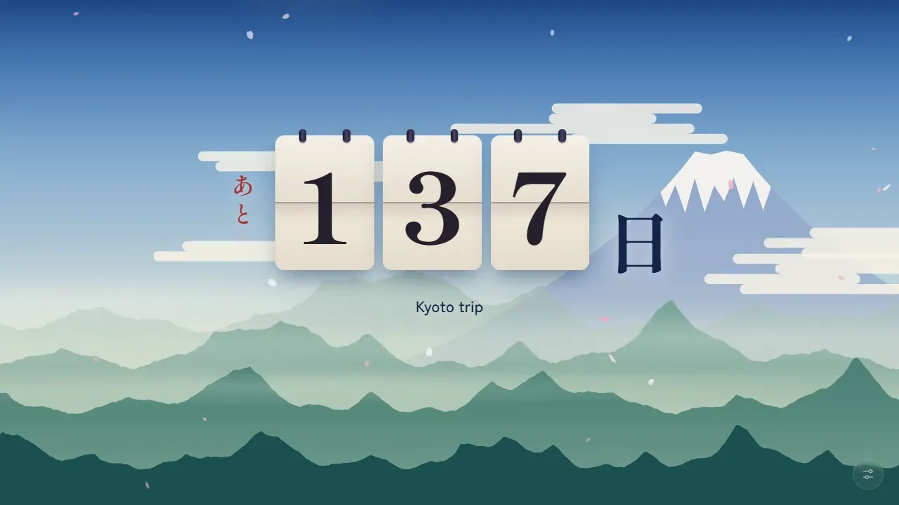

# Himekuri Countdown

**Himekuri Countdown is a free Chrome new tab extension that counts down to a date you choose on big flip-calendar cards (あと N 日, "N days left") over an animated Japanese ink-wash landscape that drifts through the day with your clock.**

  
  
  
  

  
   
  The afternoon look. Click for the 45-second video of a full day cycle.

*Himekuri* (日めくり) is the Japanese tear-off day calendar. This extension turns every new tab into one.

## Why Himekuri Countdown

- **One permission.** It asks only for `storage`. It cannot read your tabs or the sites you visit.
- **Four ink-wash scenes, drawn live on a canvas.** Morning, afternoon, evening and night melt into each other on a canvas as your clock moves, with no sudden switch.
- **Three levels of detail.** Show just the days, days and hours, or a countdown that flips every second.
- **Daylight-saving safe.** The maths uses wall-clock time, so a clock change never adds or drops a day.
- **Synced and live.** Settings sync through your Chrome account, and every open new tab updates when you change the date.

## Features

**Countdown**
- Name your countdown (up to 60 characters), pick a date and an optional time.
- **Days**: just the day count. The day before shows 1, and on the day itself it reads "is here".
- **Days and hours**: adds an hours row (時間).
- **To the second**: hours, minutes and seconds (時間 分 秒), flipping live.
- Past dates are rejected, and when a countdown ends a **Set a new date** button appears.

**Background**
- **Follows the time of day** (default), **loops through a whole day in 5 minutes**, or pins one look.
- The four looks, and when each is at its fullest (in between, the scene is a blend of the two):
  - Morning (7:00 to 8:30): red rising sun, a line of cranes, pink mist
  - Afternoon (12:30 to 15:00): Mount Fuji, woodblock-blue sky, banded kasumi clouds
  - Evening (18:00 to 18:45): sunset behind the ridge, a torii gate, crows heading home
  - Night (21:30 to 4:30): moon and stars
- **Falling petals**: turn the sakura on or off.

**Comfort**
- If your system has "reduce motion" turned on, the cards and background stay still and the scene redraws once a minute.

## Install

1. Download or clone [cool-chrome-extensions](https://github.com/kyameinsahilwho/cool-chrome-extensions).
2. Open `chrome://extensions` and turn on **Developer mode** (top right).
3. Click **Load unpacked** and select this `himekuri-countdown` folder.
4. Open a new tab. If Chrome asks whether to keep the changed new tab page, choose **Keep it**.
5. Enter what you are counting down to, the date, and press **Start countdown**.

To edit later, use the sliders button in the bottom-right corner.

### Show it on startup or behind the Home button

Extensions cannot point the Home button at their own page without a fixed ID, so use Chrome's settings:

- **On startup**: Settings > On startup > *Open the New Tab page*.
- **Home button**: Settings > Appearance > Show home button > *New Tab page*.

## How it works and privacy

- Your countdown is stored with `chrome.storage.sync`, so it follows your Chrome profile. Nothing is sent to any other server.
- The only network request is for two Google Fonts (Shippori Mincho B1 and Zen Kaku Gothic New).
- If you open `newtab.html` directly as a plain page, it falls back to `localStorage`, which is handy for previewing changes.

## Files

- `manifest.json`: Manifest V3 config with the new tab override
- `newtab.html`, `styles.css`: page and design
- `countdown.js`: flip cards, countdown maths, settings sheet
- `scene.js`: canvas background, the four looks and how they blend (the hours are in `phaseAt`, the loop length is `LOOP_SECONDS`)

## FAQ

### Is Himekuri Countdown free?

Yes. It is free, needs no account and has no paid features.

### How do I change the countdown date?

Click the sliders button in the bottom-right corner of the new tab, choose a new date and press **Save changes**.

### Can I count down to a specific time, not just a day?

Yes. Add an optional time in the settings sheet and switch the display to **Days and hours** or **To the second**.

### Why does Chrome ask me to keep the new tab page?

Chrome shows that prompt for any extension that replaces the new tab page. Choose **Keep it** to use Himekuri Countdown.

### Does it track me or read my browsing?

No. It only has the `storage` permission, stores your countdown in your Chrome profile and loads nothing but its fonts.

### Can I stop the animation?

Yes. Turn on "reduce motion" in your operating system and the cards and scene stay still. For a calmer page that still moves a little, turn off **Falling petals** and pin one look in **Background**.

---

**Part of [CodingMarvel](https://codingmarvel.com).** More in this collection: [Item Numbers](../item-numbers) · [Grok Chat Date Categorizer](../grok-chat-date-categorizer) · [all Chrome extensions](https://github.com/kyameinsahilwho/cool-chrome-extensions)

More from CodingMarvel: [Ehmatrix](https://ehmatrix.codingmarvel.com) · [Pollytasks](https://pollytasks.codingmarvel.com) · [HabitGrid](https://habitgrid.codingmarvel.com) · [Love for PDF](https://pdf.codingmarvel.com) · [Video Grid Maker](https://video-grid-maker.codingmarvel.com)
